# Bereiche (Areas) und Mähaufträge

Mit Bereichen lässt sich eine Karte in Teile zerlegen, die einzeln gemäht
werden: der Vorgarten am Montag, der Rest am Freitag, oder nur das Stück unter
dem Baum, nachdem die Blätter weg sind. Mehrere Bereiche lassen sich zu einem
Mähauftrag kombinieren, sofort aus dem Main-Dashboard oder im Zeitplaner.

Die Beispiele verwenden die Karte **Karte 1** mit den Bereichen **Area 1**
(ein Rechteck über die Mitte) und **Area 2** (ein Bereich unter Area 1, frei
mit dem Lasso gezeichnet).

Verfügbar ab MowMate v1.14.0.

## Begriffe

| | Karte | Bereich (Area) |
|---|---|---|
| Inhalt | Perimeter, Exclusions, Dockpunkte, Suchdraht, Route über die ganze Fläche | Auswahlfläche, eigene Mäh-Einstellungen, eigene Route |
| Geometrie | gehört der Karte | wird von der Karte übernommen, nicht kopiert |
| Bearbeiten der Geometrie | im Karteneditor | nur in der Karte; im Bereich grau und gesperrt |
| Unterbereiche | – | erlaubt (zum Ordnen); jeder mäht seine eigene Auswahl |

- Ein Bereich mäht, was **im Perimeter und in seiner Auswahl** liegt, um die
  Exclusions herum. Die Auswahl darf über den Perimeter hinausragen.
- Auch ein **Unterbereich** ist nur durch Perimeter und Exclusions begrenzt,
  nicht durch die Auswahl des Bereichs darüber. Die Ebenen dienen zum Ordnen;
  ein neuer Unterbereich übernimmt Auswahl, Route und Einstellungen seines
  Elternbereichs als Startpunkt.
- Ein Auftrag verwendet immer die **gespeicherten** Versionen der Bereiche.

## Bereiche verwalten

### Kartenauswahl

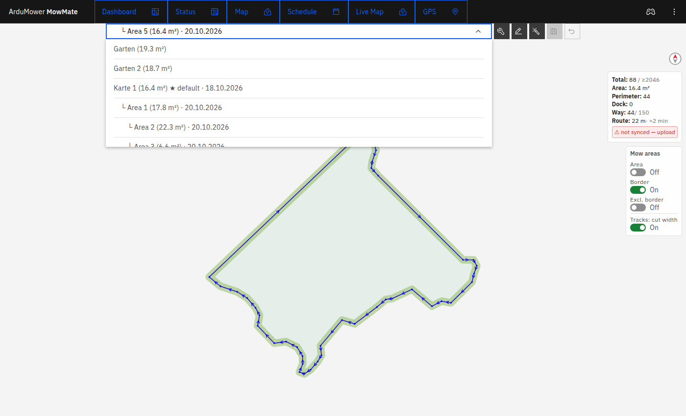

Die Kartenauswahl im Karteneditor zeigt die Karten als Baum, die Bereiche
eingerückt darunter. Hinter dem Namen stehen Fläche und Datum der letzten
Änderung; „★ default“ markiert die Karte, die das Modem beim Start lädt,
„⇡ on mower“ die Karte, die der Mäher gerade hat.

### Bereich anlegen

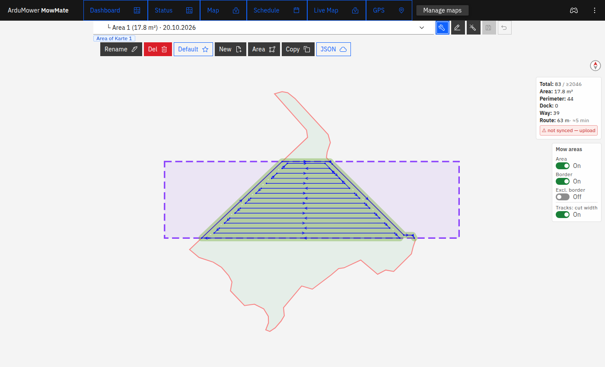

1. Die Karte (oder den Bereich, unter dem der neue liegen soll) laden.
2. Sie muss **gespeichert** sein: Der Bereich übernimmt die gespeicherte
   Geometrie.
3. **Manage maps** (Schraubenschlüssel) → **Area**.

Der neue Bereich heißt „… area“ und wird gleich geladen. Umbenennen geht wie
bei Karten mit **Rename**. **Del** löscht einen Bereich samt seinen
Unterbereichen; die Rückfrage listet sie auf.

### Ein geladener Bereich

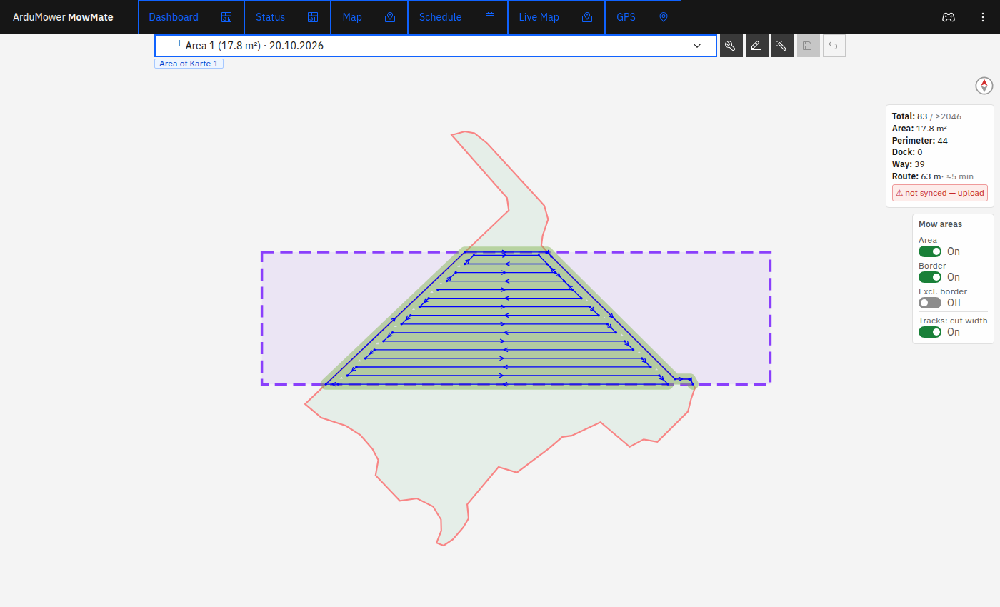

- Die Auswahl ist violett gestrichelt umrandet.
- Perimeter und Exclusions der Karte sind zu sehen, lassen sich hier aber nicht
  ändern. Das Schild **Area of Karte 1** unter der Auswahl nennt die Karte.
- Die Route ist die des Bereichs; die Schalter **Mow areas** gelten wie bei
  einer Karte für ihn allein.

### Auswahl zeichnen

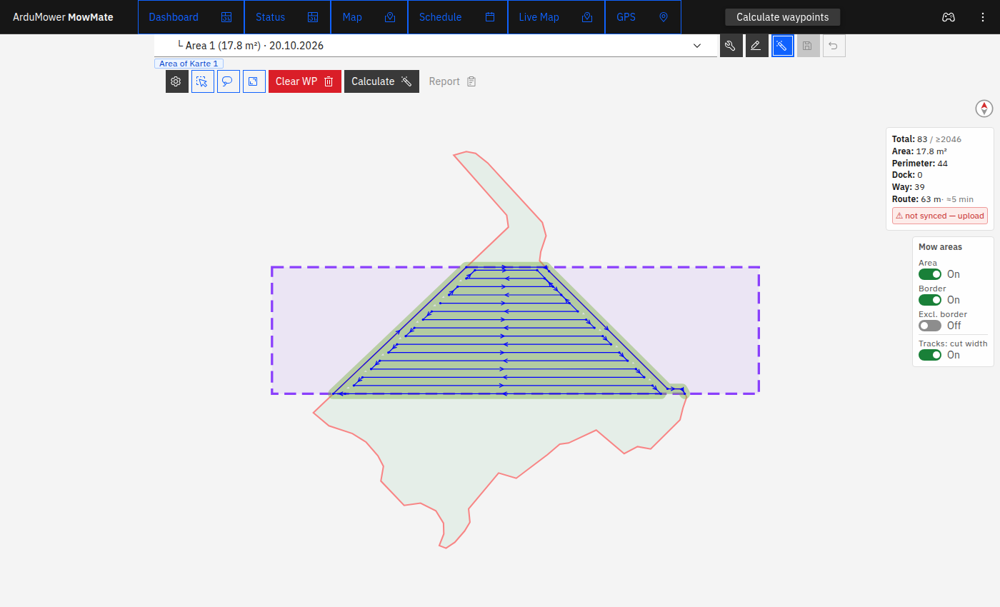

In der Leiste **Calculate waypoints** (Zauberstab) stehen bei einem Bereich drei
Werkzeuge neben dem Zahnrad:

| Symbol | Werkzeug | Bedienung |
|---|---|---|
| Fensterauswahl | Rechteck | auf der Karte ein Rechteck aufziehen |
| Lasso | Lasso | den Umriss frei zeichnen; loslassen schließt ihn |
| Vollbild | ganze Karte | Auswahl auf die ganze Karte setzen |

Danach **Calculate**. Die neue Auswahl geht sofort ans Modem, die Berechnung
verwendet sie also gleich.

### Auswahl nachbearbeiten

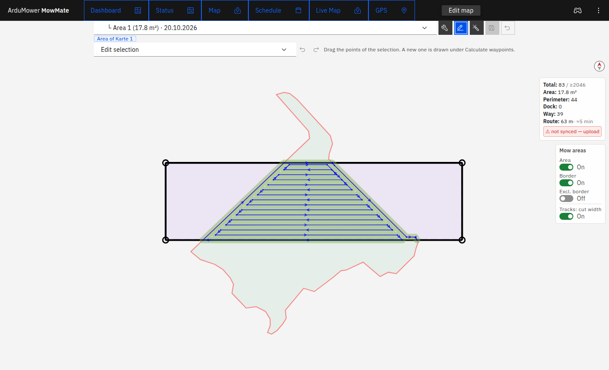

Im Karteneditor (Stift) unter **Edit selection** lassen sich die Eckpunkte der
Auswahl verschieben, mit Rückgängig und Wiederholen. Eine ganz neue Auswahl
wird in der Leiste **Calculate waypoints** gezeichnet.

### Mäh-Einstellungen eines Bereichs

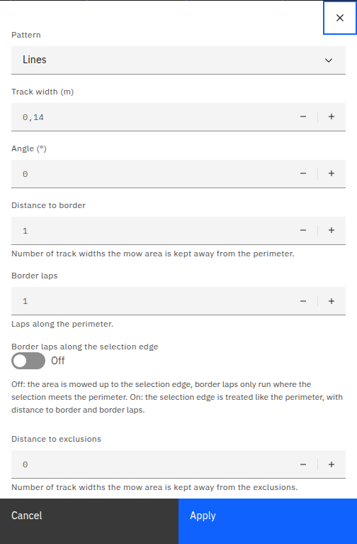

Jeder Bereich hat eigene Mäh-Einstellungen (Muster, Spurbreite, Winkel,
Randabstand, Randrunden, Reihenfolge …). Dazu kommt bei Bereichen:

**Border laps along the selection edge**

- **Aus (Standard):** Die Fläche wird bis an die Auswahlkante gemäht.
  Randrunden laufen nur dort, wo die Auswahl auf den echten Perimeter trifft.
- **An:** Die Auswahlkante wird wie der Perimeter behandelt, mit
  **Distance to border** und **Border laps** ringsum.

Den Schalter **Border** unter **Mow areas** blendet in beiden Fällen auch diese
Runden aus.

### Unterbereiche

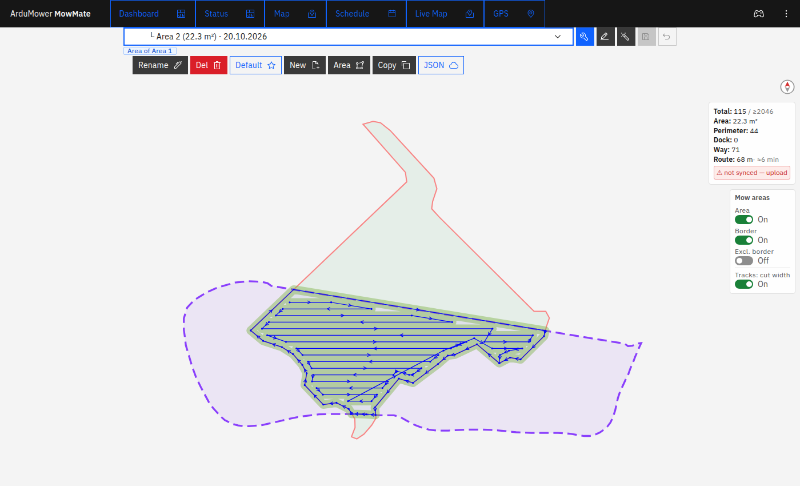

Area 2 liegt unter Area 1 (Schild **Area of Area 1**). Ihre Lasso-Auswahl reicht
weit über die von Area 1 und über den Perimeter hinaus; gemäht wird der Teil im
Perimeter.

### „Veraltet“

Ein Bereich, dessen Route nicht mehr zu Geometrie oder Auswahl passt, steht in
der Kartenauswahl mit **⚠ recalculate**, neben seinem Schild erscheint
**⚠ Route outdated**. Das passiert,

- wenn die Geometrie der Karte geändert und gespeichert wurde,
- wenn sich die Auswahl des Bereichs geändert hat.

Dann den Bereich laden und **Calculate** drücken. Veraltete Bereiche lassen sich
nicht in einen Auftrag aufnehmen. Geänderte Mäh-Einstellungen allein machen eine
Route nicht veraltet.

## Mähaufträge

### Bereiche wählen

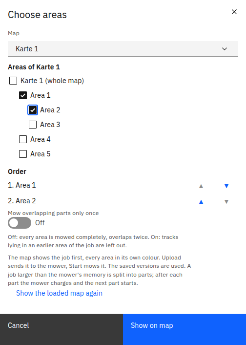

Main-Dashboard → **Areas** (Listensymbol in der Leiste unten):

1. Oben die **Map** wählen, jede gespeicherte Karte ist möglich, auch ohne
   Bereiche. Eine Karte ohne Bereiche ist sofort angekreuzt.
2. Die ganze Karte und/oder Bereiche ankreuzen.
3. Unter **Order** die Reihenfolge mit ▲/▼ festlegen.
4. Bei zwei oder mehr Bereichen: **Mow overlapping parts only once**
   - **Aus (Standard):** Jeder Bereich wird vollständig gemäht, Überlappungen
     doppelt.
   - **An:** Bahnen, die in einem früheren Bereich des Auftrags liegen, entfallen;
     die Reststücke werden um die Exclusions herum verbunden. Neu berechnet
     wird nichts.
5. **Show on map**.

Der Dialog merkt sich die Auswahl. **Show the loaded map again** verwirft die
Vorschau.

### Vorschau, Upload und Start

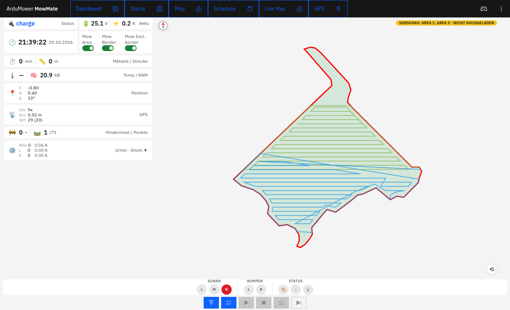

Das Modem setzt die Routen zusammen. Main-Dashboard und Live-Karte zeigen den
Auftrag, jeden Bereich in eigener Farbe; oben rechts steht **Vorschau: Area 1,
Area 2 · nicht hochgeladen**.

- **Upload** (Pfeil nach oben) schickt den Auftrag zum Mäher.
- **Start** mäht ihn. Solange nur die Vorschau existiert, ist Start gesperrt.
- Die Schalter **Mow areas** im Main-Dashboard gelten für den Auftrag: Was dort
  aus ist, entfällt in allen Bereichen. Nach einem Umschalten wird der Auftrag
  neu zusammengesetzt und muss erneut hochgeladen werden.

Läuft der Auftrag, werden gemähte Bahnen grau, der Status heißt **Auftrag: …**,
und der Wegpunktzähler zählt über den ganzen Auftrag.

### Große Aufträge

Vor dem Upload schätzt das Modem aus dem freien Speicher des Mähers, wie viele
Punkte passen. Ein größerer Auftrag wird in **Teile** zerlegt, möglichst an der
Grenze zwischen zwei Bereichen:

1. Teil hochladen und mähen.
2. Am Ende fährt der Mäher zur Station (ohne Station bleibt er stehen).
3. Ist der Akku voll (Ladestrom höchstens 0,2 A für zwei Minuten, spätestens
   nach fünf Stunden), lädt das Modem den nächsten Teil hoch und startet ihn.

Der Status zeigt **Teil 2/3** usw. Die Serie endet, wenn der Mäher mitten in
einem Teil gestoppt wird oder einen Fehler meldet, wenn eine andere Karte
hochgeladen oder ein neuer Auftrag gestartet wird. Laden mitten in einem Teil
gehört zu Sunrays normalem Ablauf und beendet sie nicht. Nach einem Neustart des
Modems ist die Serie vergessen.

## Zeitplaner

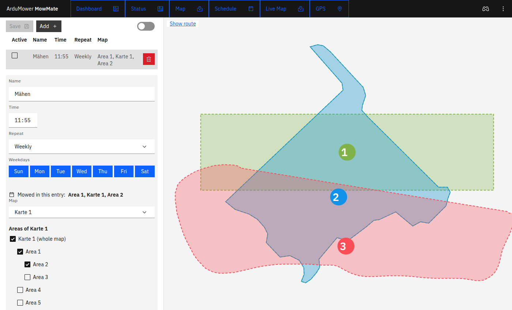

**Schedule** im Hauptmenü. Links stehen die Einträge und der Editor des gewählten
Eintrags, rechts die Karte des Eintrags, auch wenn sie nicht geladen ist.

- Ein Eintrag mäht eine Liste von Bereichen in fester Reihenfolge, gewählt wie
  im Dialog **Choose areas**. Ein neuer Eintrag (**Add**) beginnt ohne Karte.
- Die Karte zeigt die Bereiche in Farbe mit ihrer Nummer im Auftrag. Im Beispiel:
  1 = Area 1, 2 = Karte 1 (ganze Karte), 3 = Area 2.
- Änderungen gelten erst nach **Save**. Bis dahin trägt **Schedule** im
  Hauptmenü einen gelben Punkt.
- Der Schalter oben rechts schaltet den ganzen Zeitplaner ein und aus.

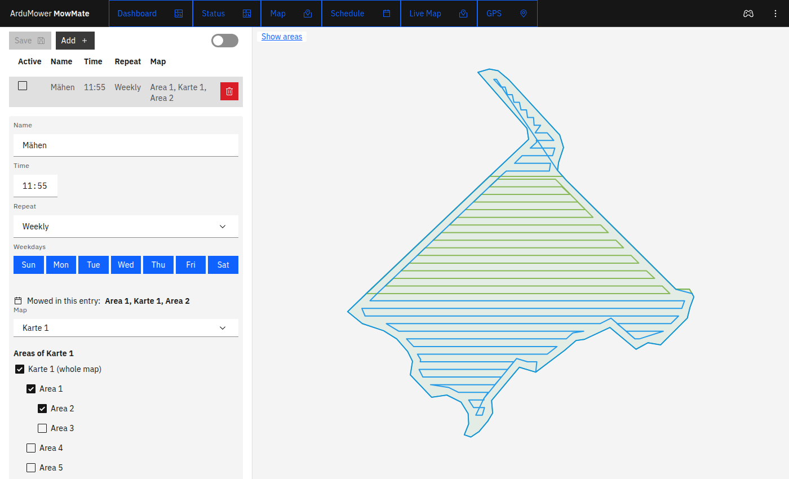

**Show route** oben links lässt das Modem den Auftrag zusammensetzen und zeigt
seine Route, **Show areas** schaltet zurück. Im Beispiel ist **Mow overlapping
parts only once** an: Area 2 liegt ganz in Karte 1, die vorher gemäht wird,
deshalb fehlen ihre Bahnen.

Der Zeitplaner startet seine Einträge als Aufträge, große werden auch hier in
Teile zerlegt. Ein Termin wird übersprungen, solange der Mäher mäht oder eine
Serie läuft, auch während er zwischen zwei Teilen lädt.

Wird ein Bereich umbenannt, ändern sich die Namen in den Einträgen mit. Wird eine
Karte oder ein Bereich gelöscht, werden die Einträge, die ihn nutzen,
ausgeschaltet, nicht gelöscht.

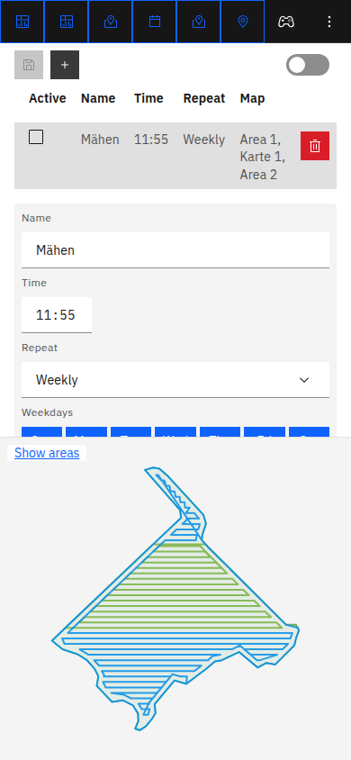

Auf dem Handy liegt der Editor über der Karte und ist ein Scrollbereich.

## Export und Import

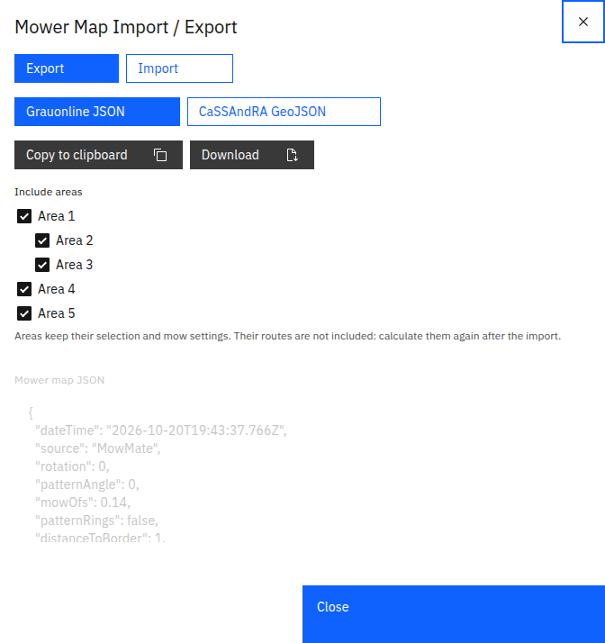

Karteneditor → **Manage maps** → **JSON**, Format **Grauonline JSON**:

- Beim **Export** einer Karte stehen ihre Bereiche unter **Include areas**. Ein
  Häkchen an einem Bereich setzt auch die Bereiche darüber, ein entferntes
  Häkchen entfernt auch die darunter.
- Bereiche werden mit Auswahl und Mäh-Einstellungen exportiert, **ohne Route**.
- Beim **Import** einer Datei mit Bereichen stehen sie unter **Import areas**.
  Das Modem speichert die importierte Karte sofort (Bereiche brauchen eine
  gespeicherte Karte), legt die Bereiche an und markiert sie mit
  **⚠ recalculate**: Sie müssen einmal berechnet werden.

Dateien ohne Bereiche importieren wie bisher. CaSSAndRA GeoJSON enthält keine
Bereiche.

## Häufige Fragen

**Warum fehlt der Knopf „Area“?** Er ist gesperrt, solange die Karte ungespeicherte
Änderungen hat oder noch nie gespeichert wurde.

**Warum kann ich einen Bereich nicht ankreuzen?** Seine Route ist veraltet
(**⚠ recalculate**). Bereich laden und neu berechnen.

**Werden ungespeicherte Änderungen gemäht?** Nein. Aufträge und Zeitplaner
verwenden die gespeicherten Versionen. Ein gelber Punkt an **Map** im Hauptmenü
zeigt ungespeicherte Änderungen an.

**Was passiert mit einer Exclusion am Rand der Auswahl?** Exclusions gelten für
alle Bereiche der Karte; die Route führt um sie herum, auch Verbindungsfahrten
zwischen den Bereichen eines Auftrags.
